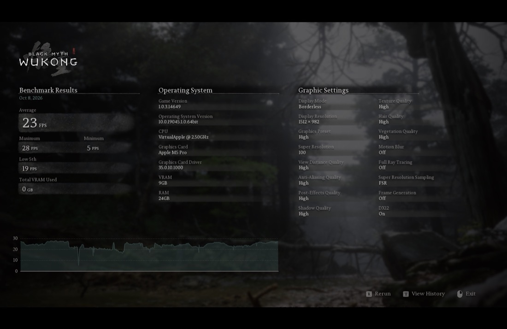
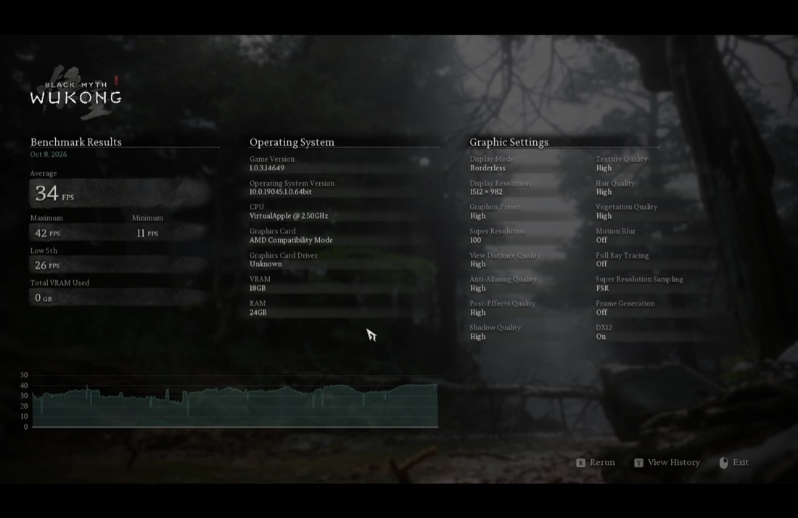

# Mullion

Mullion translates Direct3D 10, 11 and 12 to Metal, so Windows games run on Apple silicon through Wine. It is free and open source.

This is a pre-release. Expect games that break, and please report them.

## How it runs today

| | Mullion | D3DMetal |
|---|---|---|
| Black Myth: Wukong benchmark, High preset, 1512 × 982, TSR at 100%, no frame generation | 28 FPS | 34 FPS (D3DMetal 4.0 beta 3) |
| God of War Ragnarök, High preset, 1512 × 982, no vsync, where a save starts | 26 to 28 FPS, 35 ms of GPU time a frame | 29 to 40 FPS, 22 to 25 ms of GPU time a frame (D3DMetal 4.0 beta 3) |
| 3DMark Fire Strike | 7003 | |

Both columns were measured on the same Mac. The God of War numbers are premature: they come from screenshots taken while the game was still compiling shaders, not from a benchmark. Time Spy's graphics tests render correctly, though 3DMark does not report a score for them yet. Steel Nomad does not start yet.

| Mullion | D3DMetal |
|---|---|
|  |  |
|  |  |

Direct3D 12 is supported at feature level 12_1 with shader models up to 6.6, including conservative rasterization (tier 1, emulated), ray tracing at tier 1.1, mesh and amplification shaders, tessellation, geometry shaders, stream output, sampler feedback, reserved resources, pipeline libraries and planar video formats. Direct3D 10 and 11 are supported at feature level 11_1. Next for Direct3D 12 are shader model 6.7, D3D11On12, a Metal 4 backend, and more work on performance and reliability.

## Requirements

- A Mac with an M3 or later. M1 and M2 are in progress.
- macOS 15 or later.
- Wine for x86_64. Stock Wine works, with no patches and no DLL overrides. Only 64-bit games run for now.

## Install

1. Download the latest [release](https://github.com/dttdrv/mullion/releases) and unpack it.
2. Run `./install.sh <wine> [prefix ...]`. `<wine>` is the directory that contains `bin/wine`.

The script copies the libraries into `<wine>/lib/wine`, where they replace Wine's Direct3D, and into each prefix named on the command line. Prefixes created later need nothing.

In CrossOver, rename `CrossOver.app/Contents/SharedSupport/CrossOver/lib/dxmt` to `dxmt-original`, put the unpacked release folder in its place under the name `dxmt`, and set the bottle's graphics to DXMT. Replace the whole folder: CrossOver's 32-bit DXMT cannot drive Mullion, and the release's empty `i386-windows` leaves 32-bit games on Wine's own Direct3D. On the first launch macOS blocks `winemetal.so`; allow it under System Settings, Privacy & Security, and start the game again. A CrossOver update brings back its own DXMT.

The archive has the layout of DXMT's builds (`x86_64-windows` and `x86_64-unix`), so tools that install DXMT can install Mullion the same way. To install by hand, copy both directories into `<wine>/lib/wine`, and the DLLs of `x86_64-windows` into `drive_c/windows/system32` of each existing prefix.

## Settings

| | |
|---|---|
| `MULLION_LOG_PATH=<directory>` | Writes a log file for each DLL. Attach it to bug reports. |
| `MULLION_CONFIG="dxgi.customVendorId=106b"` | Reports Apple's vendor ID. By default Mullion reports the GPU's own name with AMD's vendor ID, because some games exit at startup when they do not know the vendor. |

Options can also go in a `mullion.conf` next to the game's executable, or in the file `MULLION_CONFIG_FILE` names. The `mullion.conf` in this repository lists them. The `DXMT_` names and `dxmt.conf` of earlier builds still work.

## Building

You need macOS, Meson 1.3 or later, Xcode with its Metal toolchain, LLVM 15 as static libraries for x86_64, [llvm-mingw](https://github.com/mstorsjo/llvm-mingw) and a Wine build tree.

```sh
git submodule update --init
meson setup build --cross-file build-win64.txt \
  -Dnative_llvm_path=<llvm> -Dwine_build_path=<wine build tree> \
  --buildtype release --prefix "$PWD/install"
meson install -C build
```

`install/` then has the layout of a release. With `-Dwine_builtin_dll=false` the DLLs are built for a prefix's `system32` instead, and need `WINEDLLOVERRIDES="d3d12,d3d12core,d3d11,d3d10core,dxgi=n"`.

## Tests

About 200 test programs draw, read the result back and compare it with what the Direct3D specification says, each run as every Apple GPU family. Wine's and vkd3d-proton's Direct3D tests also run against Mullion, and their verdicts are recorded in `tests/conformance`.

Configure with `-Denable_tests=true`, then run the suite in a Wine:

```sh
python3 tests/run.py --build build --wine <wine> --prefix <prefix> --family native,9
```

The tests compile their own shaders, so the prefix needs `d3dcompiler_47.dll` (from [winetricks](https://github.com/Winetricks/winetricks)) and `dxcompiler.dll` (from [DirectXShaderCompiler](https://github.com/microsoft/DirectXShaderCompiler)) in its `system32`.

## Reporting a problem

Open an issue with the Mac model, the macOS version, how the game was run, and the log. A screenshot helps most. Reports of games that work are welcome as well. Patches are covered in `CONTRIBUTING.md`.

## Credits

Mullion is built on [DXMT](https://github.com/3Shain/dxmt) by Feifan He and CodeWeavers, from commit `7c8dee1` (16 September 2026). DXMT provides the Direct3D 10 and 11 foundation, the DXBC shader converter and the Metal bridge. The DXIL front end and most of Direct3D 12 were written for Mullion, about 28,000 lines of source and 78,000 lines of tests so far.

Mullion is a separate project. Please do not report its problems to DXMT.

Thanks to [DXVK](https://github.com/doitsujin/dxvk), whose utility code DXMT carries; to [Wine](https://www.winehq.org) and [LLVM](https://llvm.org); to Microsoft for the [DirectX specifications](https://microsoft.github.io/DirectX-Specs/) and [DirectXShaderCompiler](https://github.com/microsoft/DirectXShaderCompiler); to Apple for the [Metal documentation](https://developer.apple.com/documentation/metal); and to [vkd3d-proton](https://github.com/HansKristian-Work/vkd3d-proton) and [Mesa](https://www.mesa3d.org), whose tests and drivers we learned from.

## License

LGPL, version 2.1 or later, like DXMT. See `LICENSE`. `LICENSE.OLD` is the license DXMT had before April 2026, which still covers the code from then.
